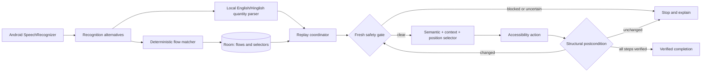

# Voice Macro Studio — deadline delivery

Date: 2026-09-30  
Build: `0.4.0-quantity` (version code 26)  
Package: `dev.voicemacro.studio`

## Installable APK

File: `dist/VoiceMacroStudio-v0.4.0-quantity-debug.apk`  
Size: 2,020,501 bytes  
SHA-256: `22B67F650F26DE9C9C74A7F5F321A77246C58261DEACD3397A2B4AE0C3327566`

This is an installable debug-signed hackathon APK, not a production Play Store release. Install it with:

```powershell
& 'C:\Users\DELL\AppData\Local\Android\Sdk\platform-tools\adb.exe' install -r '.\dist\VoiceMacroStudio-v0.4.0-quantity-debug.apk'
```

## Validated deadline scope

- Live teaching and local Room persistence for a demonstrated Zomato flow.
- Exact and wrapper-paraphrase voice matching.
- Correct-item replay using semantic context and recorded normalized position.
- Spoken quantity 1–5 for a learned single-tap item.
- English digit/word and Hinglish quantity parsing; live tests passed for `three` and `do`.
- Fresh safety check immediately before every dispatched action.
- Structural postcondition verification after every action.
- Manual Stop latch, unknown-command rejection, existing-cart rejection, and out-of-range rejection.
- Login/password/OTP/payment/unreadable screens fail closed. Payment blocking passed on the physical phone.
- English/Indian speech recognition and spoken feedback use Android platform services; no paid API is required.

## Architecture pipeline



Teaching follows the reverse path: an explicitly started recording observes safe accessibility events, stores the target class/ID/text/context/position in one Room transaction, and stops before sensitive or unreadable screens. Raw screen trees, credentials, OTPs, and payment data are not stored.

## Suggested unedited demo under five minutes

1. Open Voice Macro Studio and show `Accessibility: connected`.
2. Open the learned Zomato menu with the brownie absent and show the blue ready banner.
3. Say `Add three choco chip brownie safe`; show quantity 3 and `Replay completed and verified ... Quantity 3`.
4. Remove the item fully, Recheck, then say `Do choco chip brownie safe`; show quantity 2 and verified completion.
5. While quantity 2 remains, request quantity 3; show `Replay not started: item already has quantity 2` and unchanged cart.
6. Say `Add six choco chip brownie safe`; show rejection to quantity 1–5 and unchanged cart.
7. Tap Stop Safety, say the learned command, and show `Replay stopped by safety check` with no item change.
8. If time permits, show the already-tested payment handoff: orange payment block, with no order placement.

Do not show account credentials, OTPs, full addresses, or payment details in the recording.

## Honest limitations

- Quantity generalization is limited to a learned single-tap Zomato item and requires that item to begin absent from the cart.
- Selecting a different item without teaching it first is not implemented.
- Saved-address selection is not implemented.
- Swiggy withholds a usable accessibility tree on the tested Android 16 phone and therefore remains safely blocked.
- Hinglish live evidence covers `do`; other supported parser words have JVM tests but were not all measured with live speech.
- The full original T1–T14 reliability matrix and 20-utterance sample were not completed before the deadline.
- The APK is debug-signed for hackathon installation.

See `memory.md` for dated evidence and `implementation-plan.md` for the original full-scope phase gates.
