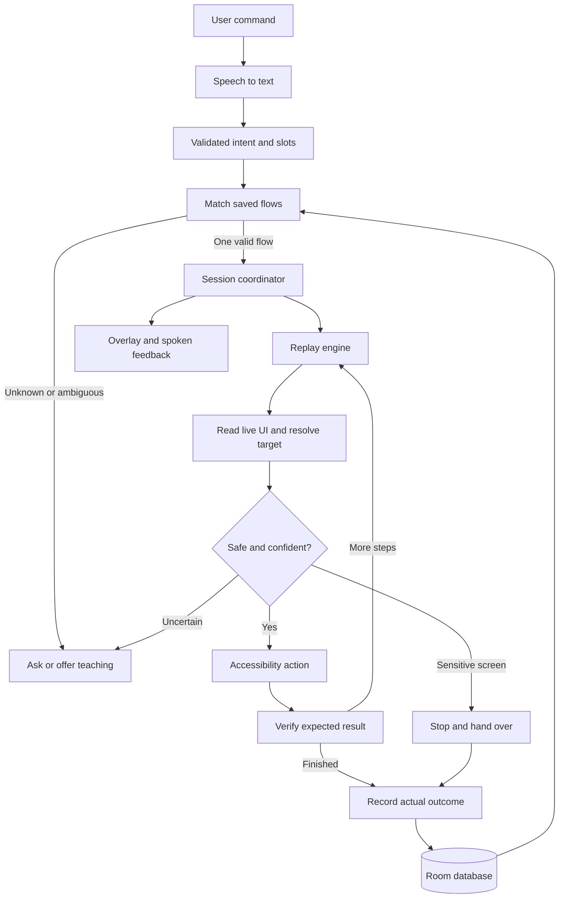

# Voice Macro Studio — Implementation Plan

Planning baseline: 2026-09-28. Status: draft pending the user's scope, device, and processing choices. No application code has been created or tested.

Update: completion target is September 29, 2026; official hackathon deadline is September 30. Budget is zero, and spoken language scope is English and Hinglish. The user is installing Android Studio. Target apps are Zomato and Swiggy, both installed and logged in on the user's Android 16 phone. USB testing is available; connectivity and accessibility coverage are not yet verified.

First demonstration target: teach a Zomato flow for finding a restaurant/item and preparing a cart up to the sensitive-screen boundary. Prefer an item without mandatory customization. After the core gates pass, teach a separate Swiggy flow and validate generalization there. Specific restaurants/items will be selected from available options on the device. No purchase is needed for the demonstration.

### Deadline and zero-budget execution plan

- September 28 setup window: install Android Studio/SDK, connect physical phone, select two apps, check their accessible UI trees, and establish free API access. Begin Phase 0 validation once the environment is ready.
- September 29 first work block: finish safety and capture gates, teaching, speech parsing, and exact replay (Phases 1–5).
- September 29 second work block: parameter changes, uncertainty, unknown/ambiguous commands, status reporting, and second-app testing (Phases 6–10).
- Reserve the final 3–4 working hours on September 29 for regression, release APK, documents, and demo recording. Skip optional Phase 11 and cross-app-transfer bonuses unless required checks already pass.
- This is an aggressive target, not a feasibility guarantee. Inaccessible target apps or failed gates require immediate scope discussion; do not silently drop required tests or claim untested completion.
- Proposed free stack: built-in Android speech recognition, Android TTS, Room, accessibility actions, and a Gemini API model explicitly available on the account's free tier. No billing setup, paid fallback, or paid backend. Verify current model access and quotas before selecting a model.
- For English/Hinglish, test real mixed Hindi/English utterances and entity names early. Offer transcript correction and clarification when recognition is uncertain; these do not replace the required voice demo. Avoid integrating a large offline speech model under this deadline unless device recognition proves unusable.
- Use one parsing request per new command when possible. On quota exhaustion/network failure, report the issue and offer retry or explicit selection of a learned flow; do not manufacture intent or switch to a paid model. Free-tier data terms must be considered when choosing what command context to send.

## 1. Inputs and intended outcome

Reviewed every page of `prd.pdf`, `architecture.pdf`, `design.pdf`, `phases.pdf`, and `rules.pdf`. These are the supplied specifications; there were no Markdown source files or application sources in the folder at review time.

Build an Android assistant that learns a native-app task from a spoken command and a live demonstration. It stores a reusable flow, recognizes later commands, changes supported parameters, and replays through accessibility actions. It stops for uncertainty and hands control to the user on login, password, OTP, or payment screens.

Required delivery: installable APK, source repository, architecture diagrams, declared target apps, known limitations, and an unedited video of at most five minutes in this order: teach, exact replay, paraphrase, changed parameter, stuck-and-asks.

## 2. Decisions needed before implementation

1. Submission date and available working time; hackathon-only APK or eventual public distribution?
2. Two target apps, exact example tasks, and access to suitable test accounts. App names in the PDFs are examples, not selected targets.
3. Physical Android phone model/version, access to USB debugging, and whether Android Studio/SDK are already installed. Hardware-dependent validation requires a connected device or the user's manual testing.
4. Online AI allowed or fully offline? API provider/budget if online; do not put secrets in chat, source code, or memory.md.
5. Spoken languages: English, Hindi, Hinglish, or another set. Target-app UI languages also need to be declared.

Provisional approach: Kotlin, minimum SDK 26 as specified, a simple native UI, local Room storage, Android speech recognition behind an interface, and a replaceable intent parser. Final dependency versions and target SDK will be selected during setup after checking compatibility. No promise of offline speech on every device.

## 3. Architecture

Start with one Android application module and clear package boundaries. This keeps the initial build manageable without coupling recognition, replay, and storage.

| Component | Responsibility |
| --- | --- |
| UI + ViewModels | Onboarding, Teach/Run controls, saved flows, history, settings |
| Session coordinator | Owns execution state, cancellation, interruption, and resume |
| Speech adapter | Microphone to transcript; recognition availability and errors |
| Intent parser | Transcript to validated intent and typed slots |
| Flow matcher | Select only among saved flows; ask when missing or ambiguous |
| Accessibility gateway | Read live nodes and execute supported accessibility actions |
| Safety policy | Block sensitive screens before recording data or issuing actions |
| Recorder | Capture relevant demonstrated actions and coalesce noisy events |
| Template builder | Bind demonstrated values and selectors to named parameters |
| Replay engine | Resolve a step, check safety, act, verify, then advance |
| Recovery handler | Bounded retries and specific questions when progress is uncertain |
| Repository / Room | Save versioned flows, steps, slot definitions, and run outcomes |
| Feedback | Always-visible status, immediate Stop control, concise spoken updates |

The language model interprets commands; it does not independently invent a flow or issue arbitrary screen actions. Replay follows steps learned from the user. Target-app content is data, never instructions to the parser.

### Teaching pipeline

1. User chooses Teach, selects the target app, and supplies a command.
2. Capture microphone input intentionally, transcribe it, and associate it with the teaching session.
3. As the user demonstrates, check the active screen for sensitivity before collecting recordable text or saving event payloads.
4. Accept only actions belonging to the selected task app. Pause for unrelated foreground apps, incoming calls, system screens, and interruptions; exclude our overlay and keyboard UI as targets. Preserve legitimate text changes in the target app.
5. Build semantic selectors using resource ID, text/description, class, ancestors, and collection context. Coalesce typing changes into final edits and distinguish state changes from user actions.
6. Stop at the user's Done action or a sensitive boundary. Never record credential values.
7. Bind known command parameters to entered text and selected targets; unresolved bindings require review. Persist the learned flow and announce exactly what was learned.

Phase 3 can record using a typed command label. Full voice-driven teaching is verified after Phase 4, resolving the dependency in the supplied phase sequence.

### Replay pipeline

1. Transcribe the command and parse a strict schema: allowed flow ID/hint, typed slots, and confidence.
2. Match only saved flows. Unknown commands offer teaching; missing parameters and close matches ask before execution.
3. Confirm the target app and starting state. Initially the user may need to open the app to the demonstrated starting screen; no deep-link shortcuts.
4. Bind slots and validate values against the learned flow's supported actions.
5. For each step, read the current UI, check safety, find a unique target, recheck cancellation/window validity and safety immediately before dispatch, execute once, and verify the expected result.
6. Do not advance just because an accessibility action returned success. Observe an expected state change; avoid duplicating non-idempotent actions such as Add to cart when a timeout leaves the outcome uncertain.
7. Ask a specific question within 30 seconds of an unresolved state. Recovery actions must be safe, unambiguous, and pass the same safety gate; an arbitrary X button is not automatically safe to click.
8. Persist the outcome and answer status questions from verified observations.

Example: after teaching “add one Margherita pizza,” “add two garlic breads” changes the item selector and desired quantity. Repeating the original taps blindly would not satisfy this requirement.

### State and storage

States: Idle, Listening, Teaching, Matching, Replaying, Asking, WaitingForUser, Completed, Cancelled, Failed. Only Replaying can dispatch actions, and every dispatch must pass the safety policy. Stop cancels queued work. Resume requires a fresh screen check; tapping Resume never bypasses a sensitive-screen block. Process restart does not resume automation automatically.

Extend the PDF schema with:

- Flow: ID, name/description, package, schema version, start-state expectations, creation time.
- Step: composite key (flow ID, order), action enum, selector, value/slot binding, precondition, expected postcondition, timeout, retry policy.
- SlotDefinition: composite key (flow ID, name), type, required flag, validation constraints, and reviewed bindings.
- RunLog: run ID, nullable flow ID for unmatched attempts, start/end, explicit outcome, last verified step, stop reason, and minimal non-sensitive summary.

Use foreign keys and transactional flow saves. Store minimal semantic information; never persist password/OTP/CVV text, raw sensitive UI trees, or API keys in Room logs. Address examples and transcripts can contain personal information, so minimize retention and provide deletion. If online parsing is chosen, send only necessary command/context data, not whole screen trees; provider credentials need a deliberate secure configuration, not a key embedded in a distributable APK.

Outcomes must distinguish COMPLETED, READY_FOR_USER, NEEDS_CLARIFICATION, CANCELLED, and FAILED. Reaching payment is READY_FOR_USER, not evidence of payment or order placement.

## 4. Phases and completion gates

Preserve the supplied 0–12 ordering. Do not start the next phase until the current phase's required checks pass. Record incomplete device checks honestly and resolve them before advancing dependent work.

| Phase | Work | Required completion evidence |
| --- | --- | --- |
| 0 — Setup | Confirm scope/device/toolchain; create Android project, accessibility service, Room skeleton, basic UI and speech/TTS interfaces | APK installs; user can enable service; sanitized events arrive on device |
| 1 — Safety first | Sensitive-screen detector, common action gate, recording guard, cancellation contract | Login/password/OTP/payment examples across at least two selected apps blocked; non-sensitive examples checked for false positives; no automated actions yet (T11 foundation) |
| 2 — UI capture | Semantic selectors, normalized screen signatures, task-window identification | Same manual flow inspected twice; stable fields distinguished from dynamic prices, banners, timestamps; sensitive data absent from saved diagnostics |
| 3 — Teaching | Start/stop controls, persistent overlay, event filtering, text coalescing, scroll recording, Room persistence | A real manual flow saves a correct ordered sequence and reloads after restart; interrupted actions excluded (T1 recording portion) |
| 4 — Voice and intent | Speech adapter, parser, schema validation, typed slots, clarification route | At least five varied utterances produce expected slots; malformed output, speech failure, missing slots handled; full voice-driven teaching passes T1 |
| 5 — Exact/paraphrase replay | Flow matching, execution loop, verified state transitions, Stop, safe failure on unknown states | T2 exact replay and T3 paraphrases pass; no wrong-flow execution; T11 rerun through actual executor |
| 6 — Generalization | Bind typed values and target selectors; quantity-aware actions and address selection | T4 item, T5 quantity, T6 address each change without reteaching and without unrelated changes |
| 7 — Uncertainty | Confidence thresholds, screen changes, bounded safe recovery, 30-second stuck deadline | T7 popup/pre-existing-state cases and T10 missing-target/wrong-language cases recover or ask specifically without unsafe actions |
| 8 — Unknown/ambiguous commands | Complete clarification UX and teaching offers; strengthen fail-closed branches already present in Phase 5 | T12 unknown flow and T13 close-match ambiguity ask instead of guessing |
| 9 — Reporting | History, persistent outcome details, status-query routing | T14 accurately reports both ready-for-user and unsuccessful runs, including after app restart |
| 10 — Second app | Teach an independent live flow in app B; replay and vary slots | T8 and T9 pass on app B; app A remains working. Cross-app transfer without reteaching is a separate optional experiment |
| 11 — Optional bonuses | Improve interruption filtering, mid-flow clarification, cross-app role ontology if time permits | Bonus demonstrations pass without regression; skip optional work if required tests remain open |
| 12 — Delivery | Release build/signing, README, diagrams, target-app list, limitations, demo rehearsal | Required T1–T14 checks documented; signed APK installs; unedited video follows specified order and stays within five minutes |

T7–T10 and T12–T14 are required for the full stated scope despite the supplied phases document labeling some “should-have.” Only explicit bonus work is optional unless the user changes scope.

## 5. Technical gaps and implementation decisions

- **Quantity is an action problem:** one recorded tap on '+' does not mean any requested quantity is supported. Learn a quantity-control pattern and verify its displayed state, or require an editable quantity field. If the app does not expose enough information, ask instead of extrapolating unsupported taps.
- **Selected values are parameters too:** changing an item or address must update the target selector and later references, not only typed text. Address selection should use existing saved addresses where possible; creating a new address is a separate demonstrated workflow.
- **Resource IDs are not always unique:** repeated product cards may share IDs. Resolve using parent/container context and semantic labels; ambiguous candidates must stop. Structural position alone cannot authorize a risky click.
- **Screen hashes are fragile:** normalize dynamic fields and compare stable landmarks instead of requiring equality of all visible text. A hash is evidence of state, not proof that a screen is safe.
- **Accessibility coverage varies:** inspect the two actual apps early. Missing nodes, custom drawing, or non-editable text can limit supported workflows. Coordinate fallback is deferred until evidence justifies it and it can be gated safely.
- **Safety has limits:** keyword checks alone cannot guarantee recognition of every sensitive screen. Combine password metadata, screen context, localized labels, and uncertainty handling; test against declared apps and languages. Treat universal zero-risk claims as unverified.
- **Confidence requires calibration:** an LLM's confidence number alone cannot authorize action. Combine schema validity, matched-flow evidence, required slots, and current UI evidence.
- **Speech portability:** Android SpeechRecognizer is not a universal offline engine. Dedicated on-device APIs were added in API 31 and require availability checks; older/unsupported devices need an agreed fallback or an offline engine.

## 6. How we will work and verify

For each phase: describe the intended result, implement a small slice, run relevant local checks, validate device behavior, fix failures, then update memory.md with evidence and the next step. If only the user can perform a physical-device test, provide precise steps and wait for results before marking that gate passed. Do not label generated APKs or automated tests as proof of live third-party-app reliability.

Use unit tests for safety decisions, slot bindings, selector scoring, cancellation, and outcome classification; instrumentation or fixture-app checks for accessibility actions; real-app tests for the declared T1–T14 scenarios. Fixture flows do not replace live teaching during evaluation.

Before final delivery, record device/app versions, test inputs, expected/actual results, and sample counts. Evaluate paraphrases with a declared set (for example 20 utterances, at least 18 correct for the PRD's 90% target); report measured results, not broad reliability claims from a single successful demo.

No calendar estimate is committed until the deadline, target apps, hardware, and connectivity choices are known. Prioritize required behavior, reserve delivery time, and add bonus scope only after core gates pass.

## 7. Platform references checked during planning

- Android accessibility service guide: https://developer.android.com/guide/topics/ui/accessibility/views/service
- AccessibilityService API: https://developer.android.com/reference/android/accessibilityservice/AccessibilityService
- SpeechRecognizer API: https://developer.android.com/reference/android/speech/SpeechRecognizer
- API 31 speech recognition additions: https://developer.android.com/sdk/api_diff/31-incr/changes/android.speech.SpeechRecognizer

These confirm API capabilities; they do not establish that the selected third-party apps expose sufficient UI information. That remains a device-validation gate.
